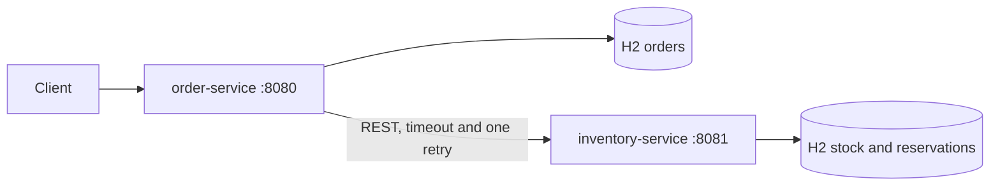

# Order Quality Lab

Two Java 17 and Spring Boot 3 microservices demonstrate domain rules, HTTP stock reservation, H2 persistence and tests from unit level through load testing. Ordering saves placed and rejected orders. Inventory reserves all lines atomically and deduplicates internal retries. No external service, API key or additional account is required. Builds, Docker Compose, k6 and JMeter run on GitHub-hosted Actions runners.



Read [the architecture](docs/architecture.md) for bounded contexts, aggregates, layers, events, process flow and consistency limits.

## Run in GitHub Actions with three commands

These commands use an existing authenticated GitHub CLI. They install nothing and run the complete order flow in Docker Compose on a GitHub runner. Delivery runs have already been started and checked by the repository authoring agent.

```sh
gh workflow run e2e.yml --repo hamza2829/order-quality-lab
gh run watch "$(gh run list --repo hamza2829/order-quality-lab --workflow e2e.yml --limit 1 --json databaseId --jq '.[0].databaseId')" --repo hamza2829/order-quality-lab --exit-status
gh run download "$(gh run list --repo hamza2829/order-quality-lab --workflow e2e.yml --limit 1 --json databaseId --jq '.[0].databaseId')" --repo hamza2829/order-quality-lab --name end-to-end
```

The Actions page also exposes manual Run workflow buttons. `make build`, `make test`, `make integration`, `make e2e` and `make perf` document the runner commands. They are optional development commands for a machine that already has Java 17, Maven, Docker Compose, Python 3, curl and make. No local setup is needed for this delivery.

## API

| Service | Endpoint | Purpose |
|---|---|---|
| Inventory | `PUT /api/stock/{sku}` | Set available stock, body `{"available":10}` |
| Inventory | `GET /api/stock/{sku}` | Read available stock |
| Inventory | `POST /api/reservations` | Reserve lines, idempotent by reservation ID |
| Ordering | `POST /api/orders` | Place or reject an order |
| Ordering | `GET /api/orders/{id}` | Read a saved order |
| Both | `/v3/api-docs`, `/swagger-ui/index.html` | OpenAPI and interactive API documentation |
| Both | `/actuator/health` | Health |

Example order body: `{"lines":[{"sku":"BOOK","quantity":2,"unitPrice":12.50,"currency":"EUR"}]}`. Seed stock first. A placed order returns 201. Insufficient stock returns 409 and `INSUFFICIENT_STOCK`. An unconfirmed inventory reservation returns 503 and `INVENTORY_UNAVAILABLE`. Rejected orders retain an ID and can be read. Inventory calls have a 300 ms connect timeout, an 800 ms request timeout and one retry after 50 ms for network or server errors. Stock rejection is never retried.

## Verified tests

<!-- TEST_RESULTS_START -->
Executed against [73ce0b335163](https://github.com/hamza2829/order-quality-lab/commit/73ce0b33516318ba066088e9efc98f5f7aecade2). Parameterized invocations count as separate tests. Unit tests are counted once, even though integration CI also reruns them.

| Test type | Executed | Failures | Skipped | CI evidence |
|---|---:|---:|---:|---|
| Unit | 61 | 0 | 0 | [Run](https://github.com/hamza2829/order-quality-lab/actions/runs/41856024054) |
| Integration | 20 | 0 | 0 | [Run](https://github.com/hamza2829/order-quality-lab/actions/runs/41856024780) |
| Contract | 7 | 0 | 0 | [Run](https://github.com/hamza2829/order-quality-lab/actions/runs/41856024780) |
| End to end | 5 | 0 | 0 | [Run](https://github.com/hamza2829/order-quality-lab/actions/runs/41856024495) |

Unit-only JaCoCo coverage, with an 80 percent minimum per package:

| Package | Covered lines | Total lines | Line coverage |
|---|---:|---:|---:|
| `lab.inventory.application` | 21 | 21 | 100.00% |
| `lab.inventory.domain` | 25 | 25 | 100.00% |
| `lab.order.application` | 17 | 17 | 100.00% |
| `lab.order.domain` | 41 | 41 | 100.00% |
<!-- TEST_RESULTS_END -->

JUnit 5 and Mockito test domain rules and application ports. SpringBootTest and MockMvc exercise real H2 adapters. WireMock checks request shape, confirmation shape, rejection, retry, timeout and malformed responses. REST Assured exercises both real services under Docker Compose, including accepted, rejected and multi-line flows. JaCoCo enforces at least 80 percent line coverage separately for each domain and application package in each service. Unit-only CI enforces the same rule without relying on integration coverage. Reports are uploaded even when a job fails.

## Measured performance

<!-- PERF_RESULTS_START -->
Measured in [performance CI](https://github.com/hamza2829/order-quality-lab/actions/runs/41856024222) on commit `73ce0b335163`.

| Tool | Order POST requests/s | Order POST p95 ms | Order POST error rate | Orders |
|---|---:|---:|---:|---:|
| k6 baseline | 62.43 | 10.65 | 0.000% | 3127 |
| k6 validation | 64.02 | 6.60 | 0.000% | 3206 |
| JMeter | 138.67 | 6.00 | 0.000% | 6924 |

Baseline p95 was 10.65 ms. The derived k6 validation budget was 50 ms. JMeter's overall sample error rate, including reads, was 0.000%.
<!-- PERF_RESULTS_END -->

See [performance methodology and results](docs/performance.md). The performance workflow uploads raw k6 summary exports, a k6 HTML report, JMeter CSV results, a JMeter HTML dashboard, calibration, runner details and service logs. k6 uses the `grafana/k6` Docker image. JMeter runs headless on the runner after its Apache archive checksum is verified.

## Refactoring and upgrade example

The initial implementation used springdoc 2.9.0. [A separate small commit](https://github.com/hamza2829/order-quality-lab/commit/b7cbd271bc931cdcd4f53234e52c57b91fc5f321) upgraded it to 2.9.1 after the baseline workflows passed. The workflows linked above passed after the upgrade. The upgrade and a small behavior-preserving refactoring are documented in [the upgrade example](docs/upgrade.md). Production refactoring should preserve the aggregate invariants and the reservation contract under these tests.

## Limitations

Data is synthetic. H2 is in memory and resets on restart. The load generator and both services share one GitHub runner, with one CPU and 512 MiB per service, so the measurements do not predict distributed production capacity. CI runner contention and JVM warmup affect results. The performance threshold is calibrated during each run, so it is a smoke check rather than a historical regression budget.

There is no cross-service transaction, compensation or durable event delivery. A lost inventory response can leave stock reserved for an order recorded as rejected. Client order POST requests are not idempotent. Prices are client supplied, stock administration is unauthenticated, and payments and release flows are outside this example. See the architecture document for the consequences.
