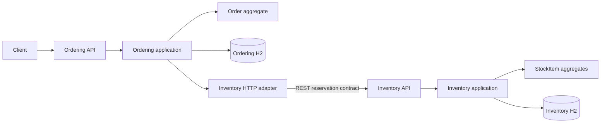
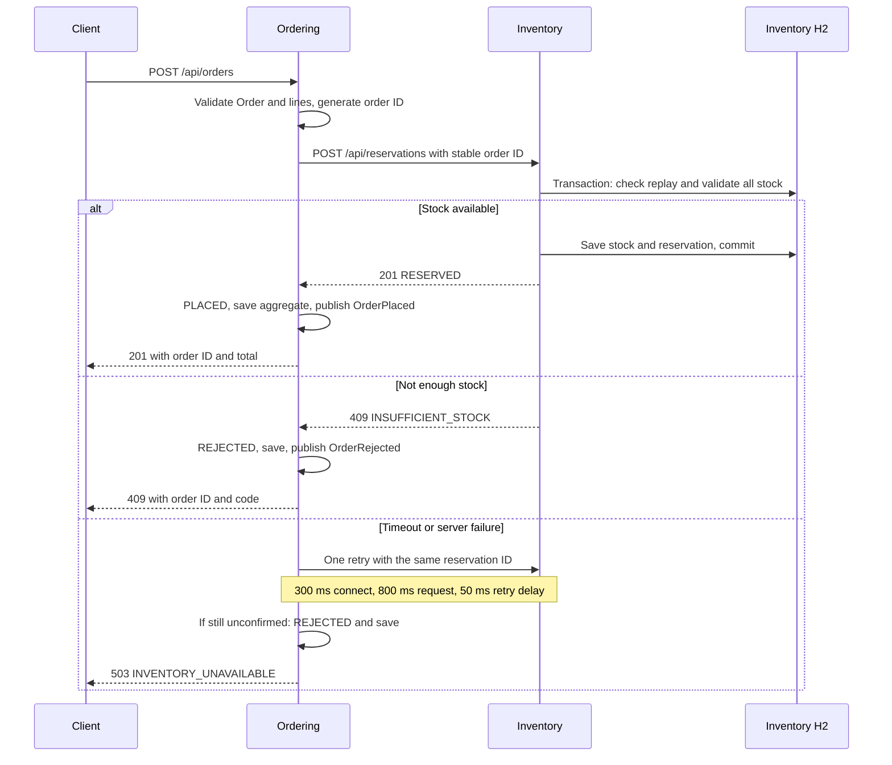

# Architecture

Two bounded contexts share an HTTP contract. Each owns its H2 database and its domain vocabulary. Neither reads the other's tables or imports the other's domain classes.

## Context map

Inventory is the upstream stock authority. Ordering is a downstream customer. The reservation API is a published language. Ordering's HTTP adapter is an anti-corruption layer: inventory JSON and HTTP statuses become application outcomes without leaking transport concerns into the domain. Sku and Quantity are separate value objects in each context, with matching contract rules. There is no shared domain module.

## Layers and aggregates

Both services use `domain`, `application`, `infrastructure` and `api` packages. The domain has no Spring imports or annotations. Spring wiring, JDBC, HTTP clients and event publication live in infrastructure. Controllers translate validated JSON into domain objects. Application services depend on repository and gateway ports.

Ordering's aggregate root is Order. Its lines cannot change after creation. It enforces 1 to 100 unique SKUs, positive quantities, nonnegative two-decimal prices, one ISO currency, exact decimal totals and a single transition from PENDING to PLACED or REJECTED. Money, Quantity and Sku are value objects. OrderRepository stores and rehydrates the whole aggregate. OrderPlaced and OrderRejected are domain events.

Inventory's aggregate root is StockItem, identified by Sku. It enforces nonnegative availability and rejects a reservation larger than available stock. Reservation is an immutable record of the complete request, sorted by SKU. InventoryRepository persists stock and reservation records. The application uses one transaction for a multi-product reservation and a process-wide lock shared with stock administration. This deliberately serializes writes for this single-process, in-memory example. A rejected line saves no stock changes. An exact replay returns the saved reservation without another deduction or event. Reusing an ID for different lines returns 409. A successful new reservation publishes StockReserved.

Events use synchronous in-process Spring publication through application ports. They are not a durable event log and do not implement an outbox.

## Order flow

## Consistency limits

There is no distributed transaction. Inventory can commit before a response is lost. After two timeouts the order is saved as REJECTED even if stock was reserved. A crash or ordering database failure after reservation can also leave reserved stock. Production would need reconciliation, a release operation, an outbox and a saga. Internal reservation retries are idempotent; client order POST requests are not. Repeating a client POST creates another order.

Stock PUT is a demonstration administration endpoint that replaces availability. Prices are supplied by the client. There is no authentication, catalog, payment, release, backorder or shipping context. The H2 database and reservation deduplication records disappear on process restart.

## API discovery

Ordering listens on port 8080 and Inventory on 8081. Each exposes `/v3/api-docs`, `/swagger-ui/index.html` and `/actuator/health`. The APIs use 400 for invalid input. Ordering additionally uses 201 for placed orders, 409 for stock rejection, 503 for inventory uncertainty and 404 for an unknown order. Error bodies have a stable code and a plain message. Reservation IDs are UUIDs; SKUs use uppercase letters, digits, underscores and hyphens.

Contract coverage combines WireMock consumer tests in Ordering with a provider integration test in Inventory using the same request and response fields. It is contract style verification, not a published Pact broker or generated Spring Cloud Contract suite.
